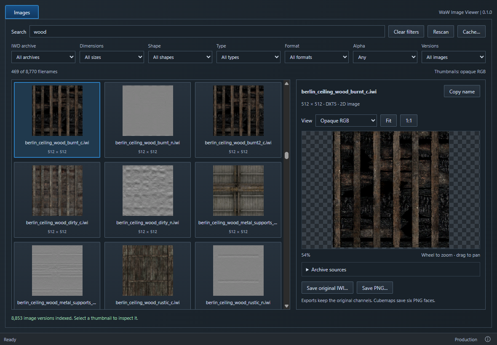

# WaW Image Viewer

**An unofficial community app. Not affiliated with Treyarch, Activision or UGX.**

Browse World at War's IWI images, find a filename by eye, and save original IWIs or PNG copies. Made by [phil81334](https://github.com/phil81334). Built with JavaScript, Rust, Vite and Tauri. No Python or Modtools needed.



## Use

1. Download `waw-image-viewer.exe` from [Releases](https://github.com/phil81334/waw-image-viewer/releases/latest).
2. Put it beside `CoDWaW.exe` and open it.
3. Search or filter, then click a thumbnail to inspect it.

The first scan takes longer. Thumbnails and the image index are cached in AppData; **Cache…** shows the folder and lets you clear it. **Rescan** reads the archives again. Game archives are never changed.

Thumbnails show opaque RGB. The preview offers transparency and individual channels, plus six faces for cubemaps. These are stored images, not rendered materials. Alpha can contain data rather than transparency. DXT1 supports optional one-bit alpha, so it appears under **Alpha: Available**.

Identical copies of a filename are grouped. Different versions remain selectable. **Copy name** copies the image name without `images/` or `.iwi`. PNG exports preserve the original channels regardless of the preview mode; cubemaps export six PNGs. Existing exports require confirmation before replacement.

## Run from source

1. Install [Node.js LTS](https://nodejs.org/) and the [Tauri Windows prerequisites](https://v2.tauri.app/start/prerequisites/#windows): Rust and Microsoft C++ Build Tools.
2. Download and extract this repository, or clone it. Open the folder in VS Code.
3. In **Terminal → New Terminal**, run:

   ```powershell
   npm install
   $env:WAW_ROOT = 'D:\Your game folder\Call of Duty World at War'
   npm run dev
   ```

For the VS Code **NPM Scripts** play button, create `.local/game-path.txt` containing just your game folder path. Then click **dev**. This is only for development; the packaged app always uses its own folder.

| Command             | What it does                                                |
| ------------------- | ----------------------------------------------------------- |
| `npm run dev`       | Opens the desktop app for development.                      |
| `npm run dev:web`   | Opens a browser preview of the UI. Cannot read game images. |
| `npm run build`     | Creates `release/waw-image-viewer.exe`.                     |
| `npm run build:web` | Builds the UI files only. No EXE.                           |

The first Rust build takes longer. Windows needs [WebView2](https://developer.microsoft.com/microsoft-edge/webview2/) (normally already installed).

[Credits](ATTRIBUTION.md) · [GPL-3.0 licence](LICENSE)
